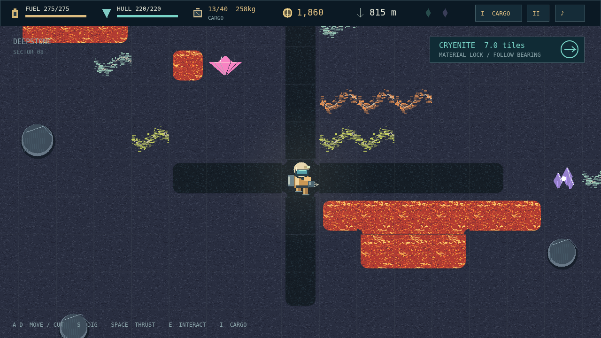

# Deepcore

Depth is cheap. Height is expensive. Stranded beside a derelict launch pad, you have a drill, a jetpack, and an entire planet between you and a way home. Carve your own passages through four layers of alien geology, bring back a hold of ore, and turn the proceeds into an escape rocket—one component at a time.

A good vein is an invitation to make a bad decision. Every mineral has weight, every drill hit spends fuel, and a heavy cargo bay climbs slower. Cut a little farther, or turn back while the return trip is still affordable? You can drop ore to regain lift, but the Credits you throw away could have paid for your next tank, a stronger hull, or the scanner that leads to a buried crystal.

Below the familiar earth, the mine starts to breathe. Pale wisps betray volatile gas; molten seams force a detour; smooth, unbreakable boulders interrupt a perfect shaft. Carry explosives, emergency supplies, or a teleporter when you can afford the insurance. At the bottom waits the Core. Extracting its final gift starts a ninety-second race back to the launch pad.

Choose a Quick, Standard, or Marathon descent, then decide what failure means. Standard lets you return to your last surface save. Hardcore erases that lifeline when you die. There are no enemies to defeat and no one coming to rescue you. Build the five rocket components, board, and leave this rock behind.

